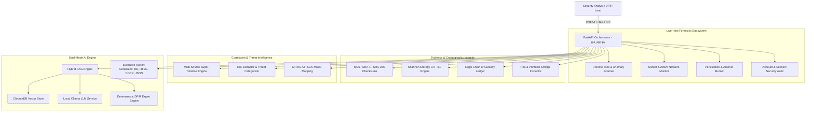
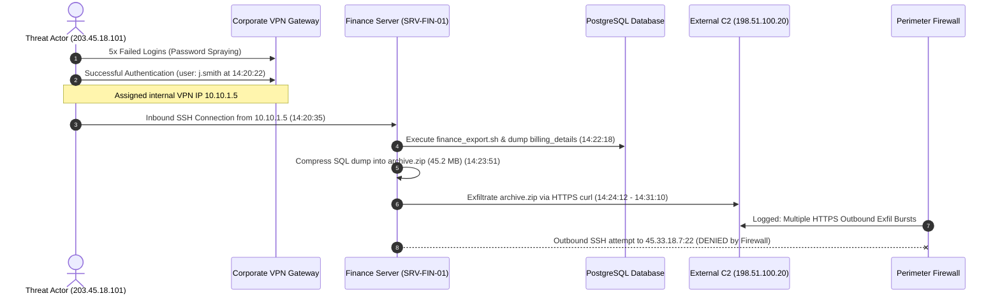

<div align="center">

# 🛡️ AgenticDFIR — Enterprise AI Cyber Forensics & Incident Response Platform

### *Autonomous, Air-Gapped DFIR Intelligence • Live System Telemetry • Forensic Super-Timeline • MITRE ATT&CK Mapping • Hybrid RAG*

[](https://www.python.org/)
[](https://fastapi.tiangolo.com/)
[](https://www.docker.com/)
[](https://render.com/)
[](https://ollama.com/)
[](LICENSE)

<br/>

[](https://render.com/deploy)

<br/>

[Key Features](#-key-features) • [Architecture](#-architecture) • [Case Study](#-case-study-the-finance-server-breach) • [Quickstart](#-quickstart-guide) • [Docker & Cloud](#-docker--cloud-deployment) • [API Reference](#-rest-api-documentation) • [MITRE ATT&CK](#-mitre-attck-matrix)

---

</div>

## 📌 Overview

**AgenticDFIR** is an enterprise-ready, privacy-first **Digital Forensics and Incident Response (DFIR)** platform designed for modern Security Operations Centers (SOCs), forensic examiners, and threat hunters.

By uniting **live host system forensics**, **cryptographic evidence integrity & Shannon entropy**, **multi-source log super-timelines**, **automated IOC threat scoring**, and a **Hybrid AI Copilot (Local Ollama + Deterministic DFIR Expert Engine)**, AgenticDFIR reduces critical incident triage time from hours to seconds—while operating **100% offline and air-gapped**.

---

## ✨ Key Features

| Capability | Description | Enterprise Value |
| :--- | :--- | :--- |
| **⏱️ Multi-Source Super-Timeline** | Parses firewall logs, OS syslogs, VPN gateways, and incident escalations into a unified chronological sequence. | Automatically detects multi-stage attacker kill chains and eliminates log silos. |
| **🔍 Live Process & Socket Triage** | Real-time process tree mapping with PPID correlation, anomaly detection (temp execution, unquoted paths, hacktools). | Immediate identification of living-off-the-land binaries (LOLBins) and C2 beacons. |
| **🔐 Cryptographic Multi-Hashing** | Simultaneous computation of MD5, SHA-1, and SHA-256 with baseline tamper detection. | Guarantees chain of custody and forensic evidence admissibility in legal proceedings. |
| **📊 Shannon Entropy Scoring** | Mathematical byte-entropy calculation ($0.0 - 8.0$ bits/byte). | Instantly flags encrypted ransomware payloads, packed malware, and obfuscated shellcode ($> 7.2$). |
| **🎯 Automated IOC & Threat Intel** | High-fidelity regex and heuristic scanner for IPs, domains, URLs, hashes, emails, and CVEs. | Maps foreign addresses to threat roles (Attacker Ingress, Exfiltration Target, Lateral Pivot). |
| **🛡️ MITRE ATT&CK Alignment** | Automated matrix alignment covering Initial Access, Credential Access, Lateral Movement, and Exfiltration. | Standardized threat actor behavioral profiling. |
| **📜 Legal Chain of Custody** | Formal tamper-evident evidence ledger tracking case metadata, custodians, and transfers. | Meets ISO/IEC 27037 standards for digital evidence handling. |
| **🔬 Hex & String Inspector** | Deep binary inspector with offset hex representation and printable ASCII/Unicode string extraction. | Rapid reverse engineering of suspicious artifacts directly in the web UI. |
| **🤖 Hybrid AI Incident Copilot** | Dual-mode AI using local **Ollama** (`llama3.2`, `qwen2.5`) with instant fallback to a built-in **Deterministic Expert Engine**. | Zero external API dependencies; 100% uptime even on air-gapped systems. |
| **📑 Executive Incident Reports** | 1-Click generation of comprehensive DFIR incident reports in **Markdown (.md)**, **Print-Ready HTML (.html)**, **Microsoft Word (.docx)**, and **JSON**. | Streamlines communication from technical analysts to C-suite leadership. |

---

## 🏗️ Architecture



---

## 🔎 Case Study: The Finance Server Breach

The platform includes a real-world forensic scenario (`CASE-2026-DFIR-001`):



The Super-Timeline correlates these fragmented logs across 4 independent sources in milliseconds.

---

## 🚀 Quickstart Guide

### 1-Click Automated Launch

#### 🍎 macOS & 🐧 Linux
```bash
git clone https://github.com/vamshichethan/AgenticDFIR.git
cd AgenticDFIR
./start.sh
```

#### 🪟 Windows
```cmd
git clone https://github.com/vamshichethan/AgenticDFIR.git
cd AgenticDFIR
start.bat
```

> **Automated Setup:** The launcher configures Python `.venv`, verifies dependencies, checks local Ollama models (with graceful fallback if uninstalled), frees occupied ports, and launches `http://127.0.0.1:8000`.

---

### Terminal CLI Console

For headless server environments or terminal-only investigations:

```bash
source .venv/bin/activate
python3 forensic_toolkit/main.py
```

---

## 🐳 Docker & Cloud Deployment

### Run via Docker Locally

```bash
# Build the image
docker build -t agentic-dfir .

# Run container
docker run -d -p 8000:8000 --name agentic-dfir agentic-dfir

# Access at http://localhost:8000
```

---

### Deploy to Render in 1 Click

[](https://render.com/deploy)

#### Render Manual Blueprint Setup:
1. Fork or push to your GitHub: `https://github.com/vamshichethan/AgenticDFIR`
2. In Render, select **New Web Service** and connect this repository.
3. Configure the service settings:
   - **Environment:** `Python` (or `Docker`)
   - **Build Command:** `pip install -r requirements.txt`
   - **Start Command:** `uvicorn gui_app:app --host 0.0.0.0 --port $PORT`
   - **Health Check Path:** `/healthz`
4. Deploy! Your DFIR suite will be live with high availability.

---

## 🔗 REST API Documentation

Full interactive OpenAPI / Swagger specifications are available at `http://127.0.0.1:8000/docs`.

### Primary Endpoints:

| Category | Method | Endpoint | Description |
| :--- | :--- | :--- | :--- |
| **System** | `GET` | `/healthz` | Container and orchestrator health check |
| | `GET` | `/api/system_info` | Host telemetry, CPU, RAM, disk, network interfaces |
| | `GET` | `/api/ollama_info` | Local LLM daemon status and model inventory |
| **Host Forensics** | `GET` | `/api/forensics/processes` | Process tree with PPID and DFIR anomaly scoring |
| | `GET` | `/api/forensics/sockets` | Listening and established network sockets |
| | `GET` | `/api/forensics/persistence` | Cross-platform autorun hooks and startup tasks |
| | `GET` | `/api/forensics/users` | Active sessions and interactive user accounts |
| **Timeline** | `GET` | `/api/timeline` | Correlated master chronological super-timeline |
| | `GET` | `/api/timeline/export/csv` | Download correlated timeline in CSV format |
| **Integrity & Custody** | `GET` | `/api/evidence/list` | Evidence artifacts with MD5, SHA-256, Entropy |
| | `POST` | `/api/hashing` | Cryptographic integrity verification against baseline |
| | `POST` | `/api/report/integrity` | Produce evidence tamper verification report |
| | `GET` | `/api/custody/ledger` | Retrieve legal Chain of Custody record |
| | `POST` | `/api/custody/transfer` | Record official evidence custody transfer |
| **Threat Intelligence** | `GET` | `/api/iocs` | Extracted threat indicators (IPs, domains, hashes, CVEs) |
| | `POST` | `/api/iocs/scan-text` | Real-time regex scan of arbitrary log text |
| | `GET` | `/api/mitre` | MITRE ATT&CK Enterprise Matrix alignment |
| **Hex Inspector** | `GET` | `/api/evidence/hex` | Binary hex dump with byte offsets |
| | `GET` | `/api/evidence/strings` | Extract printable ASCII/Unicode strings |
| | `POST` | `/api/evidence/upload` | Ingest new evidence artifact into case locker |
| **AI & Reporting** | `POST` | `/api/report/generate` | Generate executive report in MD, HTML, DOCX, JSON |
| | `GET` | `/api/report/download/{fmt}` | Download report (`md`, `html`, `docx`, `json`) |
| | `POST` | `/api/chat/query` | Natural language forensic Q&A with citations |

---

## 🎯 MITRE ATT&CK Matrix

The platform correlates evidence directly to standard MITRE ATT&CK enterprise tactics:

```text
┌────────────────────┬──────────────────┬────────────────────────────────────────────────────────┐
│ Tactic             │ Technique ID     │ Observed Forensic Behavior                             │
├────────────────────┼──────────────────┼────────────────────────────────────────────────────────┤
│ Initial Access     │ T1078.002        │ Compromised domain account (j.smith) across VPN        │
│ Credential Access  │ T1110.001        │ 5 failed VPN logins from 203.45.18.101 before success  │
│ Lateral Movement   │ T1021.004        │ Inbound SSH pivot from VPN tunnel (10.10.1.5)          │
│ Execution          │ T1059.004        │ Execution of finance_export.sh via bash                │
│ Collection         │ T1560.001        │ Database dumped & zipped to archive.zip (45.2 MB)      │
│ Exfiltration       │ T1048.002        │ HTTPS curl upload to external C2 (198.51.100.20:443)   │
│ Command & Control  │ T1571            │ Blocked outbound SSH connection to 45.33.18.7:22       │
└────────────────────┴──────────────────┴────────────────────────────────────────────────────────┘
```

---

## 🔒 Security & Privacy Notice

* **Air-Gapped Operation:** All log parsing, cryptographic hashing, entropy calculations, vector indexing, and AI inference run strictly on your local host.
* **Zero Cloud Data Leakage:** No evidence bytes, system telemetry, or investigator queries are ever transmitted to third-party cloud services.

---

## 🤝 Contributing

Contributions from the cybersecurity and digital forensics community are welcome!
1. Fork the Project
2. Create your Feature Branch (`git checkout -b feature/AmazingFeature`)
3. Commit your Changes (`git commit -m 'Add AmazingFeature'`)
4. Push to the Branch (`git push origin feature/AmazingFeature`)
5. Open a Pull Request

---

## 📄 License

Distributed under the **MIT License**. See `LICENSE` for more information.

<div align="center">

**Built with precision for Cyber Security Analysts, DFIR Teams, and Threat Hunters.**

</div>
