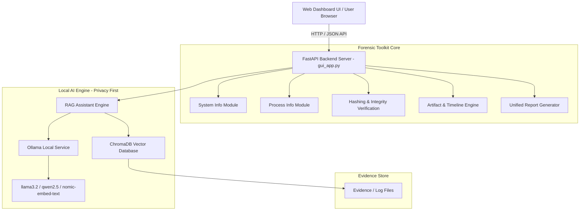

# 🛡️ AI Cyber Forensics Workshop

[](https://www.python.org/)
[](https://fastapi.tiangolo.com/)
[](https://ollama.com/)
[](https://www.trychroma.com/)
[]()

An advanced, privacy-first **AI-Assisted Cyber Digital Forensics & Incident Response (DFIR) Toolkit**. Designed for security analysts, incident responders, and forensic investigators, this platform integrates live system artifact analysis, cryptographic integrity verification, timeline construction, and local **Retrieval-Augmented Generation (RAG)** powered by offline Large Language Models via **Ollama**.

---

## ✨ Key Features

- **🤖 Local Privacy-First AI Assistant (RAG)**
  - Fully offline RAG engine backed by **Ollama**, **ChromaDB**, and **LangChain**.
  - Query complex forensic log files, incident reports, and email threads without sending data to third-party clouds.
  - Supports multiple local models: `llama3.2:1b`, `qwen2.5:1.5b`, `qwen2.5:0.5b`, and `nomic-embed-text`.

- **🔍 Live System & Process Forensics**
  - **System Profiling**: OS build details, hardware specs, network interfaces, and system uptime.
  - **Process Investigation**: Active process listing, parent-child process relationships, CPU/memory usage, and listening ports.
  - **Artifact Collection**: Rapid collection of Windows event indicators, execution logs, and network connection states.

- **🔐 Cryptographic Evidence Hashing & Integrity**
  - Instant MD5 and SHA-256 hash generation for evidence files.
  - Verification of forensic integrity against chain-of-custody reference hashes.

- **⏱️ Forensic Timeline Generator**
  - Aggregates multi-source timestamped evidence (firewall logs, system events, VPN logs, email logs) into a unified chronological investigation timeline.

- **📝 Automated Unified Reporting**
  - Generates comprehensive forensic reports in Markdown, JSON, and Microsoft Word (`.docx`) formats.

- **🌐 Interactive Web Dashboard & REST API**
  - Modern, responsive web interface built with clean HTML5/CSS3/JavaScript.
  - Powered by a high-performance **FastAPI** backend with automated OpenAPI docs (`/docs`).
  - Automated 1-click startup batch script (`start.bat`) handling environment initialization, Ollama model pulling, and server launch.

---

## 🏗️ System Architecture



---

## 📁 Repository Structure

```text
AI-Cyber-Forensics-Workshop/
├── forensic_toolkit/            # Core Python digital forensics modules
│   ├── artifacts.py             # System & network artifact collectors
│   ├── hashing.py               # MD5 / SHA-256 hash generation & verification
│   ├── main.py                  # CLI entry point for standalone forensic tools
│   ├── ollama_info.py           # Local Ollama service integration helpers
│   ├── process_info.py          # Process memory, PID & network mapping
│   ├── report.py                # Report generator (MD, JSON, DOCX)
│   ├── system_info.py           # Host system & hardware diagnostics
│   ├── timeline.py              # Chronological event timeline generator
│   └── utils.py                 # File & path helper utilities
├── rag_assistant/               # Local RAG AI assistant components
│   ├── load_documents.py        # Log & document parser
│   ├── create_embeddings.py     # ChromaDB vector store builder
│   └── rag_engine.py            # LangChain + Ollama Q&A engine
├── web_gui/                     # Frontend Web Dashboard assets
│   ├── index.html               # Main dashboard HTML interface
│   ├── app.js                   # Interactive UI application logic
│   └── style.css                # Custom UI styling & themes
├── Evidence/                    # Sample evidence files & logs for analysis
├── gui_app.py                   # FastAPI application & REST endpoint definitions
├── requirements.txt             # Python dependencies
├── start.bat                    # 1-Click launcher script for Windows
├── stop.bat                     # Shutdown script to stop server & processes
└── README.md                    # Project documentation
```

---

## ⚙️ Prerequisites

- **Operating System**: Windows 10 / 11 (or Windows Server)
- **Python**: Python 3.10 or higher
- **Ollama**: [Download Ollama for Windows](https://ollama.com/download) (or use the included `OllamaSetup.exe` installer if present).

---

## 🚀 Quick Start Guide

### Option 1: Automated 1-Click Launch (Recommended)

Simply double-click **`start.bat`** (or run it from PowerShell / Command Prompt):

```cmd
start.bat
```

**What `start.bat` does automatically:**
1. Checks for Python 3.10+ installation.
2. Creates and configures the virtual environment (`.venv`).
3. Installs all required dependencies from `requirements.txt`.
4. Verifies and launches the local **Ollama** service.
5. Downloads required Ollama models (`llama3.2:1b`, `nomic-embed-text`, `qwen2.5:1.5b`, `qwen2.5:0.5b`).
6. Starts the FastAPI server on `http://127.0.0.1:8000` and opens the Dashboard in your default web browser.

### Option 2: Manual Setup

1. **Clone the repository:**
   ```bash
   git clone https://github.com/Vu3jxg/AI-Cyber-Forensics-Workshop.git
   cd AI-Cyber-Forensics-Workshop
   ```

2. **Create and activate a virtual environment:**
   ```powershell
   python -m venv .venv
   .venv\Scripts\activate
   ```

3. **Install Python dependencies:**
   ```bash
   pip install --upgrade pip
   pip install -r requirements.txt
   ```

4. **Ensure Ollama is running and models are pulled:**
   ```bash
   ollama serve
   ollama pull llama3.2:1b
   ollama pull nomic-embed-text
   ```

5. **Start the FastAPI Application:**
   ```bash
   uvicorn gui_app:app --host 127.0.0.1 --port 8000
   ```

6. **Open the Web Interface:**
   Navigate to `http://127.0.0.1:8000` in your web browser.

---

## 🔗 Key API Endpoints

Once the application is running, full interactive OpenAPI documentation is available at `http://127.0.0.1:8000/docs`.

| Endpoint | Method | Description |
| :--- | :--- | :--- |
| `/` | `GET` | Serves the interactive Web Dashboard |
| `/api/system-info` | `GET` | Fetches host hardware, OS, and system information |
| `/api/processes` | `GET` | Retrieves active system processes and resource usage |
| `/api/artifacts` | `GET` | Collects forensic artifacts and event logs |
| `/api/timeline` | `GET` | Builds a unified timeline from evidence logs |
| `/api/hash` | `POST` | Calculates MD5 & SHA-256 hashes for uploaded/specified files |
| `/api/verify-hash` | `POST` | Verifies file integrity against a target hash |
| `/api/rag/query` | `POST` | Submits natural language queries to the local AI RAG Assistant |
| `/api/generate-report` | `POST` | Generates consolidated forensic investigation reports |

---

## 🛑 Stopping the Application

To shut down the FastAPI backend and release occupied ports, execute:

```cmd
stop.bat
```

---

## 🔒 Security & Privacy Notice

All data processing, log analysis, vector store generation, and AI inference are performed **100% locally** on your host device using local models. No evidence, telemetry, or query data is transmitted to external internet services.

---

## 📄 License

This project is released under the [MIT License](LICENSE).
